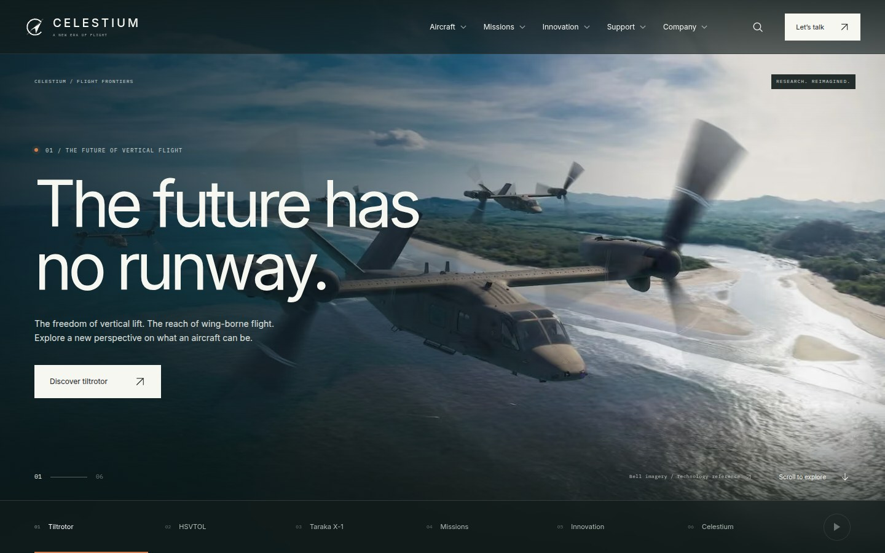

# Celestium handoff views

Captured from the verified production build on 8 October 2026. The desktop views use 1440 × 900 px; phone views use 390 × 844 px. These are viewport captures, so long pages continue below the image.

The live local preview is [localhost:3000](http://localhost:3000). Validation is recorded in [the browser summary](../validation/celestium-browser-results.json); site scope and limitations are described in [the redesign record](../CELESTIUM-REDESIGN.md).

| View                                 | Snapshot                                                                           |
| ------------------------------------ | ---------------------------------------------------------------------------------- |
| Aircraft study introduction          | [celestium-catalogue-desktop.jpg](celestium-catalogue-desktop.jpg)                 |
| Aircraft filters and study cards     | [celestium-catalogue-studies-desktop.jpg](celestium-catalogue-studies-desktop.jpg) |
| Hydrogen-electric chapter            | [celestium-energy-desktop.jpg](celestium-energy-desktop.jpg)                       |
| Interactive energy architecture      | [celestium-energy-system-desktop.jpg](celestium-energy-system-desktop.jpg)         |
| Desktop homepage                     | [celestium-home-desktop.jpg](celestium-home-desktop.jpg)                           |
| Phone homepage                       | [celestium-home-mobile.jpg](celestium-home-mobile.jpg)                             |
| HSVTOL introduction                  | [celestium-hsvtol-desktop.jpg](celestium-hsvtol-desktop.jpg)                       |
| Phone HSVTOL introduction            | [celestium-hsvtol-mobile.jpg](celestium-hsvtol-mobile.jpg)                         |
| HSVTOL cruise perspective            | [celestium-hsvtol-modes-desktop.jpg](celestium-hsvtol-modes-desktop.jpg)           |
| Dedicated medical cabin introduction | [celestium-medical-desktop.jpg](celestium-medical-desktop.jpg)                     |
| Tiltrotor introduction               | [celestium-tiltrotor-desktop.jpg](celestium-tiltrotor-desktop.jpg)                 |
| Tiltrotor transition at 45°          | [celestium-tiltrotor-modes-desktop.jpg](celestium-tiltrotor-modes-desktop.jpg)     |

The original MALUS screenshots in this folder remain historical records. Current Celestium captures use the `celestium-` prefix. Regenerate them with `node scripts/capture-preview.mjs` while a local production preview is running.

